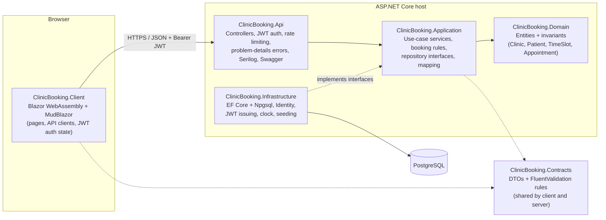
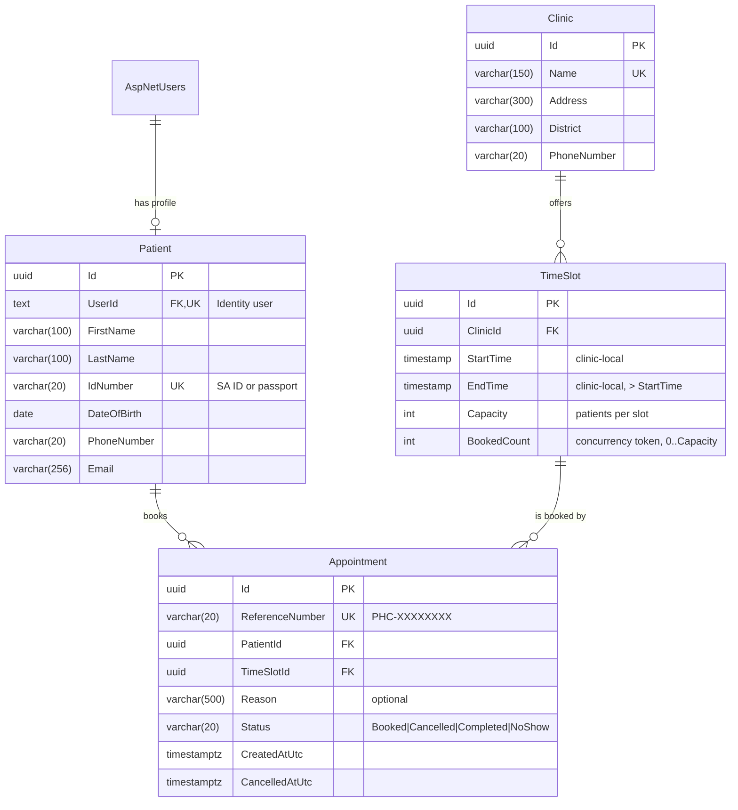
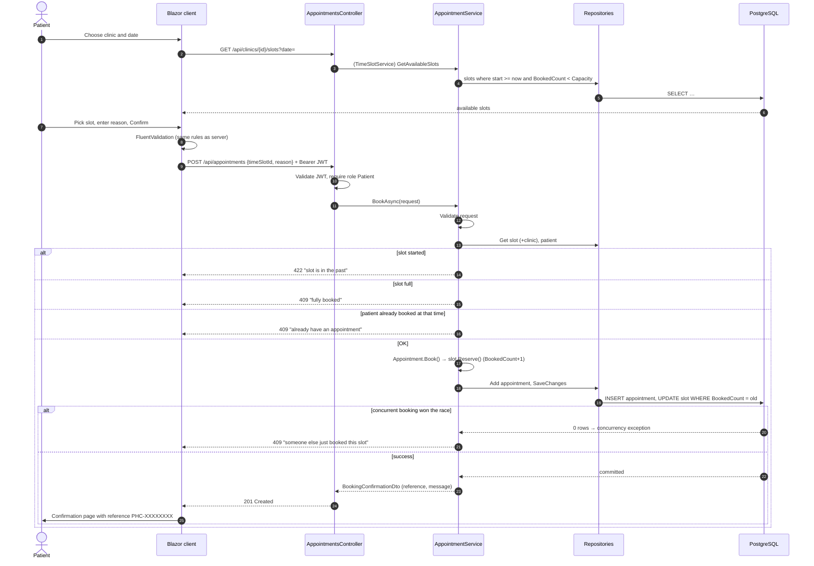
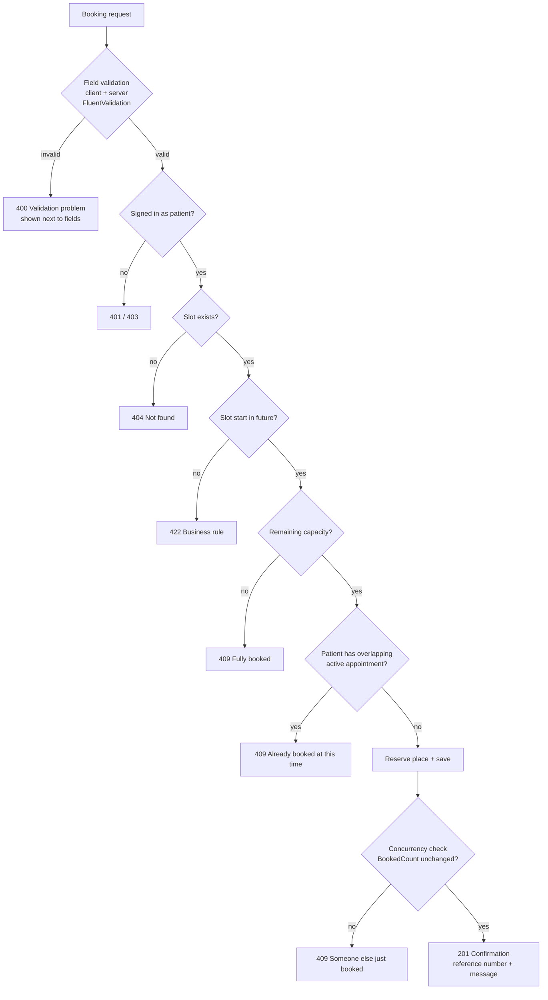
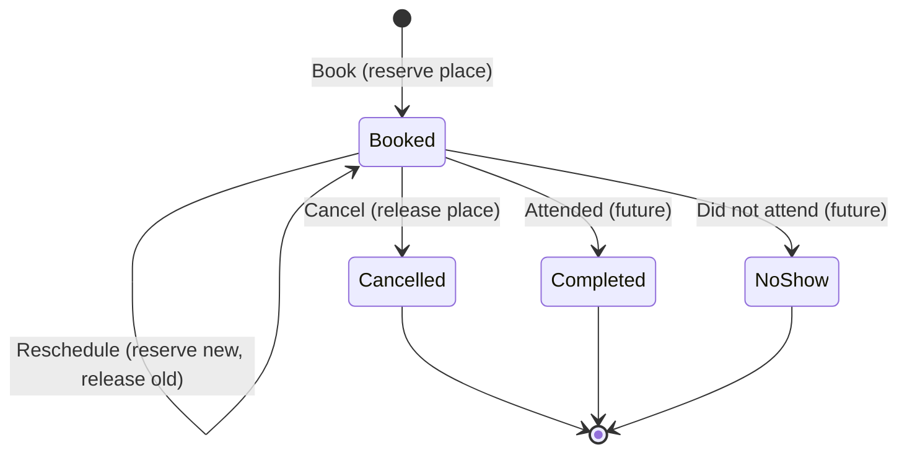

# 2. System Design

## 2.1 Architecture

The solution uses a **layered (Clean Architecture) monolith**. For one bounded context (booking) this gives clear
separation and testability without the operational cost of microservices. Each layer only depends inwards.
Moving to services later (for example a separate notifications service) would not require rewriting the core.

| Project | Responsibility | Depends on |
|---|---|---|
| `Domain` | Entities and rules that must always hold (capacity, state changes) | nothing |
| `Contracts` | Request/response DTOs and validators shared with the Blazor client | FluentValidation |
| `Application` | Use cases (book, cancel, reschedule, list, generate slots); defines `I…Repository`, `IUnitOfWork`, `ICurrentUser`, `IClinicClock` | Domain, Contracts |
| `Infrastructure` | EF Core `AppDbContext`, repositories, migrations, ASP.NET Identity, JWT generation, seed data | Application |
| `Api` | HTTP endpoints, authentication/authorisation, error mapping, logging, hosts the WASM client | Application, Infrastructure |
| `Client` | Blazor WebAssembly UI | Contracts |

**SOLID in practice**

- **S**: each service covers one area (`AppointmentService`, `TimeSlotService`, `ClinicService`); `SlotGenerator` is a pure function; controllers only translate HTTP.
- **O**: new rules or storage can be added by adding implementations. For example, an SMS notifier would be another `INotificationSender` without changing the booking code.
- **L**: repository implementations follow their interface contracts, so the unit tests use mocks in their place.
- **I**: small focused interfaces (`IClinicClock`, `IReferenceNumberGenerator`, `ICurrentUser`) rather than one large service.
- **D**: the application layer depends on abstractions; EF Core, Identity and the system clock are injected from Infrastructure.

## 2.2 Data model

**Key design decisions**

| Decision | Reason |
|---|---|
| `TimeSlot.Capacity` + `BookedCount` instead of "one appointment per slot" | Clinics often run several consulting rooms in parallel. Availability is a single indexed comparison (`BookedCount < Capacity`). |
| `BookedCount` is an **optimistic concurrency token** | Two patients racing for the last place: both read `BookedCount = 0`; the first `UPDATE … WHERE BookedCount = 0` succeeds; the second affects 0 rows → `DbUpdateConcurrencyException` → HTTP 409. No locks are held. |
| Check constraint `BookedCount BETWEEN 0 AND Capacity` | Last line of defence at the database level. |
| Filtered unique index `(PatientId, TimeSlotId) WHERE Status = 'Booked'` | A patient can never hold the same slot twice. Cancelled history is kept. |
| Slot times stored **without time zone** (clinic-local) | Clinics think in local wall-clock time; this avoids off-by-two-hours bugs in display. "Now" comes from `IClinicClock` in the configured zone. Audit timestamps (`CreatedAtUtc`) are stored in UTC. |
| Appointment status kept (soft cancel) instead of deleting | History and reporting (no-shows, cancellations); auditability. |
| `Patient` separate from the Identity user | Keeps clinical/demographic data out of the auth tables; staff accounts have no patient record. |
| GUID keys | Not guessable in URLs; can be generated by the application before saving. |

## 2.3 Booking flow (sequence)

## 2.4 Validation and error handling flow

All errors are returned as RFC 7807 **problem details** by a single `GlobalExceptionHandler`, so the client
shows one consistent, user-friendly message. Unexpected errors are logged with their stack trace and return a
generic 500 that does not expose internals.

## 2.5 Appointment lifecycle

## 2.6 API surface

| Method | Route | Who | Purpose |
|---|---|---|---|
| POST | `/api/auth/register` | anyone | Create a patient account, returns JWT |
| POST | `/api/auth/login` | anyone | Sign in, returns JWT |
| GET | `/api/clinics` | anyone | List clinics |
| GET | `/api/clinics/{id}` | anyone | Clinic details |
| POST | `/api/clinics` | Admin | Add a clinic |
| GET | `/api/clinics/{id}/slots?date=yyyy-MM-dd` | anyone | Available slots on a day |
| POST | `/api/clinics/{id}/slots/generate` | Staff, Admin | Open slots for a date range |
| GET | `/api/clinics/{id}/appointments?date=` | Staff, Admin | Day's appointment list |
| POST | `/api/appointments` | Patient | Book → confirmation |
| GET | `/api/appointments/mine` | Patient | Own appointments |
| GET | `/api/appointments/{id}` | owner, Staff | One appointment |
| POST | `/api/appointments/{id}/cancel` | owner, Staff | Cancel |
| POST | `/api/appointments/{id}/reschedule` | owner, Staff | Move to another slot |
| GET | `/health` | anyone | Liveness + database check |

Full request/response schemas are in Swagger at `/swagger` when running in Development.
